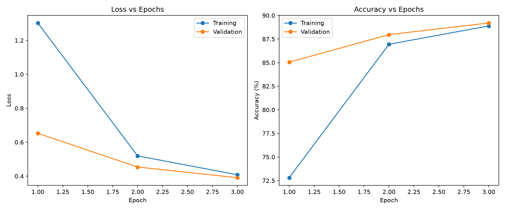
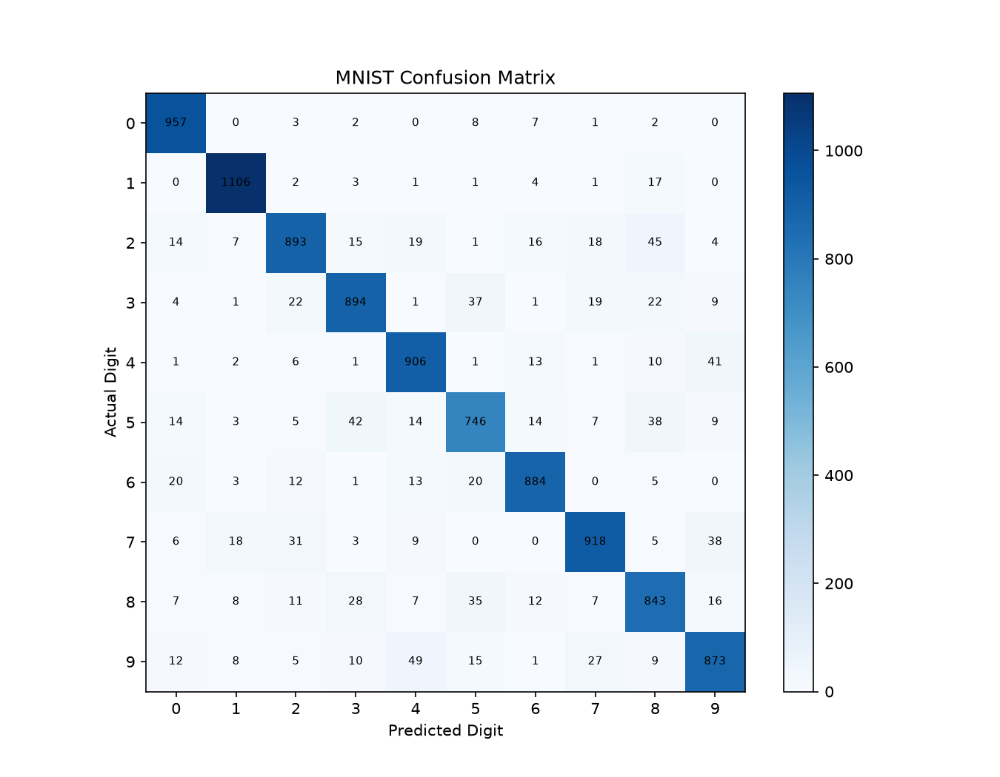
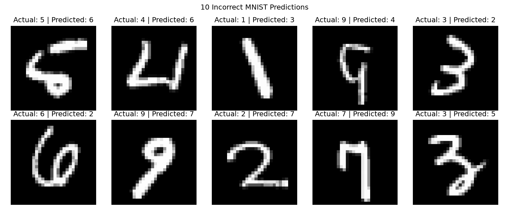

# 🧠 MNIST Neural Classifier

### Handwritten Digit Recognition Using PyTorch


An end-to-end handwritten digit classification project built with **Python and PyTorch**, using a Multilayer Perceptron (MLP) trained on the MNIST dataset.

The project covers the complete foundational deep learning workflow: **data preprocessing, neural network training, validation, checkpointing, evaluation, error analysis, inference, and automated testing.**

---

## 📊 Model Performance

The trained model achieved **90.20% accuracy** on 10,000 unseen MNIST test images.

| Metric | Result |
|---|---|
| 🎯 Test Accuracy | **90.20%** |
| ✅ Correct Predictions | 9,020 |
| ❌ Incorrect Predictions | 980 |
| 🧪 Test Samples | 10,000 |
| 🔁 Training Epochs | 3 |
| 🧠 Model | Multilayer Perceptron |
| ⚙️ Optimizer | SGD |
| 📉 Loss Function | Cross-Entropy Loss |

> This project focuses on understanding neural network fundamentals and building a reproducible machine learning workflow rather than achieving state-of-the-art accuracy.

---

## 🏗️ Neural Network Architecture

The classifier uses a feedforward neural network with one hidden layer containing 128 neurons.

```text
               MNIST Image
                 28 × 28
                    │
                    ▼
             ┌─────────────┐
             │   Flatten   │
             │  28×28 → 784│
             └─────────────┘
                    │
                    ▼
             ┌─────────────┐
             │ Linear Layer│
             │  784 → 128  │
             └─────────────┘
                    │
                    ▼
             ┌─────────────┐
             │    ReLU     │
             │ Activation  │
             └─────────────┘
                    │
                    ▼
             ┌─────────────┐
             │ Linear Layer│
             │   128 → 10  │
             └─────────────┘
                    │
                    ▼
             10 Class Scores
                (0–9)
```

### How It Works

1. **Input:** A 28×28 grayscale image is converted into a PyTorch tensor.
2. **Flatten:** The image is transformed into a vector of 784 pixel values.
3. **Hidden Layer:** A linear layer learns combinations of input features.
4. **ReLU:** Introduces non-linearity so the network can learn more complex relationships.
5. **Output Layer:** Produces 10 scores representing digits 0–9.
6. **Prediction:** `argmax` selects the digit with the highest score.

### How the Model Learns

During training, the model makes predictions using a **forward pass**. Cross-Entropy Loss measures how well those predictions match the actual digit labels.

**Backpropagation** computes the gradients of the loss with respect to the model's parameters. The SGD optimizer then uses those gradients to update the weights.

```text
Input → Forward Pass → Loss
                         │
                         ▼
                   Backpropagation
                         │
                         ▼
                   Weight Updates
                         │
                         ▼
                    Next Batch
```

Repeating this process allows the model to gradually reduce its prediction errors.

---

## 📦 Dataset

The project uses the publicly available **MNIST handwritten digit dataset**, accessed through Torchvision.

| Dataset Split | Images |
|---|---:|
| Training | 54,000 |
| Validation | 6,000 |
| Testing | 10,000 |
| **Total** | **70,000** |

Each sample is a **28×28 grayscale image** containing a handwritten digit from **0 to 9**.

The original 60,000 training images are split into training and validation subsets using a fixed random seed (`42`).

The separate 10,000-image test dataset is used to measure performance on unseen examples.

**Source:** [MNIST Dataset — Torchvision](https://pytorch.org/vision/stable/generated/torchvision.datasets.MNIST.html)

---

## 📈 Training Results

The model was trained for **3 epochs** using the following configuration:

| Parameter | Value |
|---|---|
| Epochs | 3 |
| Batch Size | 64 |
| Learning Rate | 0.01 |
| Optimizer | SGD |
| Loss Function | Cross-Entropy Loss |

### Training History

| Epoch | Train Loss | Validation Loss | Train Accuracy | Validation Accuracy |
|---|---:|---:|---:|---:|
| 1 | 1.3023 | 0.6525 | 72.81% | 85.05% |
| 2 | 0.5195 | 0.4538 | 86.94% | 87.97% |
| 3 | 0.4081 | 0.3909 | 88.89% | 89.20% |

### Loss and Accuracy Curves



**Observations:**

- Training loss decreased throughout the three epochs.
- Validation loss also decreased.
- Both training and validation accuracy improved.
- No clear evidence of serious overfitting appeared during this short training run.

The recorded metrics are available in `outputs/metrics.json`.

---

## 🔍 Model Evaluation

The trained checkpoint was evaluated against all **10,000 MNIST test images**.

### Test Results

```text
Total test images: 10000
Correct predictions: 9020
Incorrect predictions: 980
Test accuracy: 90.20%
```

### Confusion Matrix



A confusion matrix shows which digits the model predicts correctly and which digits it confuses with other classes.

- **Rows:** Actual digit labels
- **Columns:** Predicted digit labels
- **Diagonal cells:** Correct predictions
- **Off-diagonal cells:** Incorrect predictions

Unlike overall accuracy, the confusion matrix reveals the specific classes where the model struggles.

### Error Analysis



Ten incorrect predictions were collected and visualized to better understand the model's limitations.

**Key observations:**

- Certain handwritten digits have unusual or ambiguous shapes.
- Some digits contain curves and loops that resemble other digits.
- Visually similar classes are more likely to be confused.
- Incorrect predictions provide useful evidence about where the model struggles.

These observations suggest possible causes of errors but do not prove exactly why the model made each prediction.

---

## 📁 Project Structure

```text
mnist-neural-classifier/
│
├── src/
│   └── mnist_neural_classifier/
│       ├── __init__.py
│       ├── model.py            # MLP architecture
│       ├── train.py            # Training and validation
│       ├── predict.py          # Full test-set evaluation
│       ├── evaluate.py         # Confusion matrix and errors
│       └── infer.py            # Single-image inference
│
├── scripts/
│   ├── explore_data.py         # Dataset exploration
│   └── plot_metrics.py         # Training visualizations
│
├── test/
│   └── test_model.py           # Automated tests
│
├── outputs/
│   ├── metrics.json
│   ├── training_curves.png
│   ├── confusion_matrix.png
│   └── incorrect_predictions.png
│
├── config.json
├── pyproject.toml
├── uv.lock
├── .python-version
├── .gitignore
└── README.md
```

### Locally Generated Files

```text
data/                        # Downloaded MNIST dataset
checkpoints/
    best_model.pt             # Best saved model weights
```

These files are excluded from Git tracking. The dataset can be downloaded again, and the model checkpoint can be recreated by running the training script.

---

## ⚙️ Installation & Setup

### Prerequisites

- Python 3.15
- Git
- [uv package manager](https://docs.astral.sh/uv/)

### 1. Clone the Repository

```powershell
git clone https://github.com/maheenhmd/mnist-neural-classifier.git
cd mnist-neural-classifier
```

### 2. Install Dependencies

```powershell
uv sync
```

This installs the project and its dependencies, including PyTorch, Torchvision, Matplotlib, and pytest.

### 3. Explore the Dataset

```powershell
uv run python scripts/explore_data.py
```

MNIST will be downloaded automatically if it is not already available locally.

---

## 🚀 Usage

All commands should be executed from the **project root directory**.

### 1. Train the Model

```powershell
uv run python -m mnist_neural_classifier.train
```

The training script:

- Loads and prepares the MNIST dataset.
- Creates training and validation splits.
- Trains the MLP using SGD.
- Calculates loss and accuracy after each epoch.
- Saves the best checkpoint based on validation loss.
- Records training configuration and metrics.

**Generated files:**

```text
checkpoints/best_model.pt
config.json
outputs/metrics.json
```

### 2. Evaluate Test Accuracy

```powershell
uv run python -m mnist_neural_classifier.predict
```

The script loads the trained checkpoint and evaluates all 10,000 test images without updating model weights.

### 3. Generate Confusion Matrix and Error Gallery

```powershell
uv run python -m mnist_neural_classifier.evaluate
```

**Generated files:**

```text
outputs/confusion_matrix.png
outputs/incorrect_predictions.png
```

### 4. Generate Training Graphs

```powershell
uv run python scripts/plot_metrics.py
```

**Generated file:**

```text
outputs/training_curves.png
```

### 5. Run Single-Image Inference

The inference script accepts an index from the MNIST test dataset.

```powershell
uv run python -m mnist_neural_classifier.infer --index 7
```

Example output:

```text
Actual digit: 9
Predicted digit: 9
```

Another example:

```powershell
uv run python -m mnist_neural_classifier.infer --index 0
```

```text
Actual digit: 7
Predicted digit: 7
```

The script loads the saved model, selects one test image, and performs inference without retraining.

---

## 🧪 Automated Testing

Automated tests were implemented using **pytest** to verify fundamental model behavior.

| Test | What It Checks | Result |
|---|---|---|
| `test_output_shape` | Model produces 10 scores per input image | ✅ Passed |
| `test_deterministic_inference` | Same model and input produce identical outputs | ✅ Passed |

Run the test suite:

```powershell
uv run pytest -v
```

**Verified result:**

```text
2 passed
```

These tests check the model's behavior and output consistency. They do not measure classification accuracy.

---

## 🔄 Reproducibility Verification

The project was independently tested in a **fresh local Git clone** to verify that the committed code works outside the original development environment.

### Verification Results

| Check | Result |
|---|---|
| Fresh Git clone | ✅ Successful |
| Dependency installation with `uv sync` | ✅ Successful |
| Automated tests | ✅ 2 passed |
| Training from scratch | ✅ Successful |
| Model checkpoint creation | ✅ Successful |
| Test-set evaluation | ✅ Successful |
| Single-image inference | ✅ Successful |

### Original Run vs Fresh Clone

| Metric | Original | Fresh Clone |
|---|---:|---:|
| Validation Accuracy | 89.20% | 89.25% |
| Test Accuracy | **90.20%** | **90.14%** |

The fresh-clone model correctly classified **9,014 out of 10,000 test images**.

The small accuracy difference is expected because model initialization and training randomness are not fully controlled.

**Conclusion:** The project was successfully installed, trained, tested, and used for inference in a clean local environment.

---

## 🛠️ Technology Stack

| Technology | Purpose |
|---|---|
| 🐍 Python | Programming language |
| 🔥 PyTorch | Neural network training and inference |
| 🖼️ Torchvision | MNIST dataset and image preprocessing |
| 📊 Matplotlib | Training and evaluation visualizations |
| 🧪 pytest | Automated testing |
| 📦 uv | Dependency and environment management |
| 🔧 Git & GitHub | Version control and project hosting |

---

## 🧠 Key Learning Outcomes

This project provided hands-on experience with:

- Building a neural network using `torch.nn`
- Understanding tensor shapes and the forward pass
- Implementing backpropagation and gradient descent
- Managing training, validation, and test datasets
- Tracking loss and accuracy across epochs
- Saving and loading model checkpoints
- Measuring performance on unseen examples
- Creating confusion matrices and analyzing prediction errors
- Building an inference script
- Writing deterministic automated tests
- Organizing a reproducible Python ML project

---

## ⚠️ Limitations

Although the model achieves 90.20% test accuracy, it has several limitations:

- **Simple architecture:** The MLP does not explicitly exploit local spatial structure through convolutions.
- **Classification errors:** Some visually similar or unusually written digits are misclassified.
- **Dataset scope:** The model has only been evaluated on MNIST.
- **Inference interface:** The current script selects images from the MNIST test dataset rather than accepting arbitrary uploaded images.
- **Training reproducibility:** Fresh-clone execution was successful, but fully identical training results are not guaranteed because all random processes have not been fixed.

The current implementation is intended as a foundational deep learning project rather than a production-ready handwritten digit recognition service.

---

## 🗺️ Project Progress

- [x] Dataset exploration and preprocessing
- [x] MLP architecture implementation
- [x] Training and validation pipeline
- [x] Model checkpoint saving and loading
- [x] Full test-set evaluation
- [x] Confusion matrix visualization
- [x] Incorrect prediction analysis
- [x] Single-image inference script
- [x] Automated unit tests
- [x] Training loss and accuracy graphs
- [x] Fresh-clone reproducibility verification

### Possible Future Improvements

- [ ] Compare MLP performance with a CNN
- [ ] Support inference on custom handwritten images
- [ ] Add broader automated testing
- [ ] Improve training reproducibility through additional random seeds
- [ ] Experiment with alternative architectures and training configurations

---

## 👩‍💻 Author

**Maheen Hamid**

[GitHub Profile](https://github.com/maheenhmd)

---

